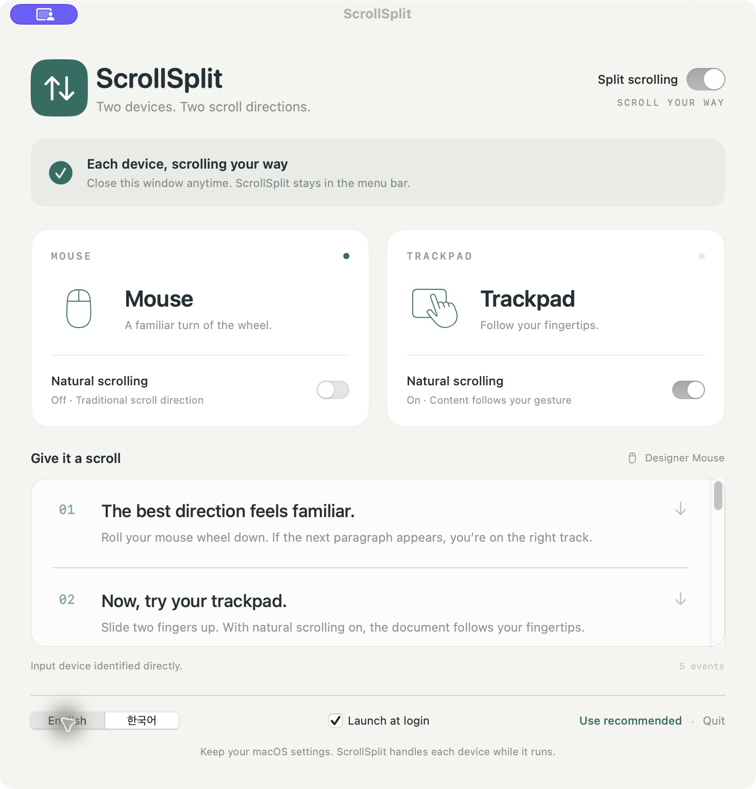
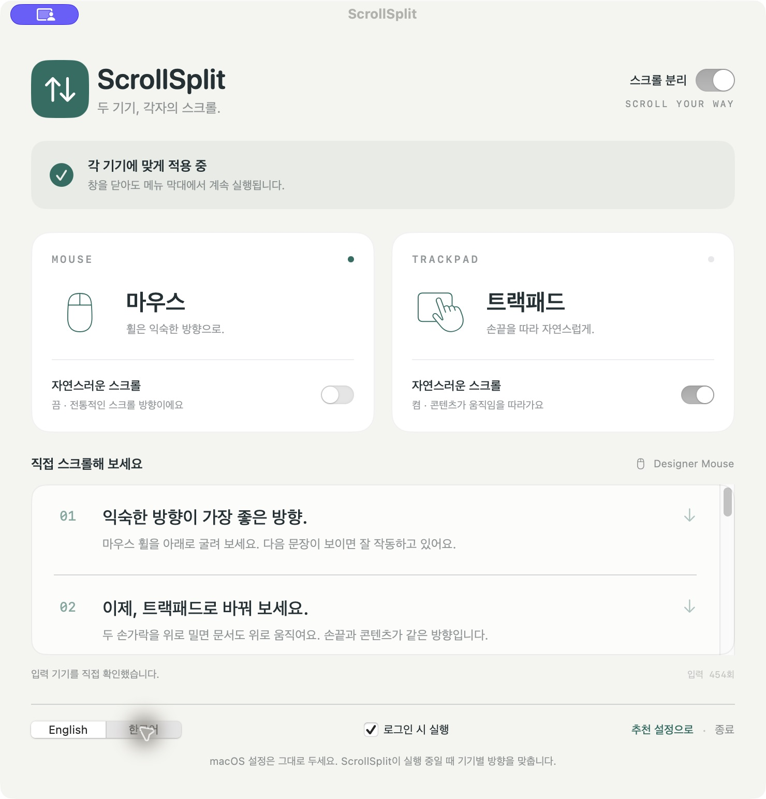

# ScrollSplit

**Two devices. Two scroll directions.**

**두 기기, 각자의 스크롤.**

A native macOS menu bar app that controls natural scrolling independently for your mouse and trackpad.

마우스와 트랙패드의 자연스러운 스크롤을 각각 설정하는 macOS 메뉴 막대 앱입니다.

[English](#english) · [한국어](#한국어)



<details>
<summary>한국어 화면 · Korean interface</summary>



</details>

## English

### What it does

Keep familiar wheel scrolling on your mouse and natural gestures on your trackpad, without changing macOS settings whenever you switch devices.

| Device | Default natural scrolling |
| --- | --- |
| Mouse | **Off** |
| Trackpad | **On** |

- Independent natural scrolling switches for each device type.
- Vertical and horizontal scrolling, including Shift + wheel.
- Menu bar controls for settings, pause/resume, and quit.
- English by default, with a persistent English / Korean language toggle.
- Optional launch at login.
- A scrollable test document with the last detected device and an input counter.
- Accessibility permission guidance and recovery after sleep or an event-tap timeout.

The app reads the natural-scrolling flag on each event and reverses it only when needed. Your macOS preference stays unchanged. Pausing or quitting restores normal system behavior immediately. The app opens in English by default. Switch instantly between **English** and **한국어** using the language toggle at the bottom of the window. Your choice is saved across restarts, independently of your Mac’s language.

### Build and run

Requirements: **macOS 13 or later**, **Swift 5.9 or later**, and Xcode or the Xcode Command Line Tools. No third-party Swift packages are required.

```sh
git clone https://github.com/sleeplesshan/scrollsplit.git
cd scrollsplit
swift test
bash scripts/build.sh
```

The build produces `dist/ScrollSplit.app` for the architecture of the Mac running the build. Install it at a stable location before granting permissions:

```sh
mkdir -p "$HOME/Applications"
ditto dist/ScrollSplit.app "$HOME/Applications/ScrollSplit.app"
open "$HOME/Applications/ScrollSplit.app"
```

This repository contains source and build scripts, not a notarized binary distribution. The build script uses ad-hoc signing by default. To use your own signing certificate:

```sh
SIGN_IDENTITY='Your signing certificate name' bash scripts/build.sh
```

For subsequent builds on this Mac, save your signing identity locally:

```sh
git config --local scrollsplit.signingIdentity 'Your signing certificate name'
bash scripts/build.sh
```

This Git setting stays on your machine and is not committed. `SIGN_IDENTITY` takes precedence; without either setting, the build falls back to ad-hoc signing. Reusing the same certificate and bundle identifier keeps the app’s signing identity stable across updates.

### First-time setup

1. Open ScrollSplit and click **Allow Access**.
2. Open **System Settings → Privacy & Security → Accessibility** and enable **ScrollSplit**. If it is missing, use `+` to add the installed app.
3. The app checks permission about every two seconds. If it still cannot connect, quit and reopen it.
4. Leave the mouse switch off and the trackpad switch on for the default combination.
5. Try both devices in the test document and in your usual apps.

Closing the window keeps the app running in the menu bar. Enable **Launch at login** to start it with your Mac account. If macOS requires approval for the login item, the app opens the relevant settings.

Rebuilding or moving an ad-hoc-signed app can invalidate its Accessibility permission, even when the old switch still appears enabled. Click **Already allowed?** in the app for help: remove ScrollSplit from Accessibility with `−`, add the current installed copy with `+`, enable it, then quit and reopen the app. **Show App** reveals the exact running copy in Finder. When changing signing certificates, this one-time reauthorization may also be required.

### How it works

A Quartz event tap listens only for scroll-wheel events. The resolver first tries to identify the sending device through HID sender information and IOKit registry properties. The direction policy compares the requested device setting with `NSEvent.isDirectionInvertedFromDevice`.

When reversal is needed, the app updates the line, fixed-point, and pixel deltas on both axes. Where available, it also updates the underlying HID values used by consumers such as WebKit. Gesture phase and momentum metadata are preserved.

### Compatibility and limitations

For device identification and raw HID updates, the app optionally resolves these symbols at runtime: `CGEventCopyIOHIDEvent`, `IOHIDEventGetSenderID`, `IOHIDEventGetFloatValue`, and `IOHIDEventSetFloatValue`. These are **not public SDK APIs** and may change in a future macOS version. This implementation is not intended for Mac App Store distribution.

If direct device identification is unavailable:

- Discrete scroll events are treated as mouse input.
- Continuous events with a gesture phase or momentum phase are treated as trackpad input.
- Other continuous events are left unchanged because their device type is uncertain.

Magic Mouse, smooth-scrolling drivers, remote desktop, and Universal Control need device-specific testing. Other scroll-reversing apps or mouse drivers can conflict with this app.

### Privacy and validation

ScrollSplit does not monitor keyboard input, send network requests, store input logs, or include analytics. The input counter and last detected device exist only in memory. Preferences are saved locally with `UserDefaults`. Building requires the Apple developer tools; the running app has no network dependency.

The four automated tests cover all device/system direction combinations, pause behavior, unknown inputs, momentum fallback, and preservation of fractional deltas and event metadata. Local checks confirmed a release build, app launch, Accessibility authorization, and direct identification of a Designer Mouse. Physical trackpad direction, wake recovery, and launch after a fresh login still require manual verification.

### Uninstall

Turn off launch at login in the app, quit from the menu bar, and delete `ScrollSplit.app`. No macOS scroll preference needs restoring.

### License

No project license has been selected. Public availability does not by itself grant permission to reuse or redistribute this project's code.

## 한국어

### 주요 기능

마우스는 익숙한 휠 방향으로, 트랙패드는 손끝을 따라가는 자연스러운 방향으로 사용합니다. 기기를 바꿀 때마다 macOS 설정을 바꿀 필요가 없습니다.

| 기기 | 자연스러운 스크롤 기본값 |
| --- | --- |
| 마우스 | **끔** |
| 트랙패드 | **켬** |

- 마우스와 트랙패드의 자연스러운 스크롤을 각각 설정합니다.
- 세로·가로 스크롤과 Shift + 휠에 적용합니다.
- 메뉴 막대에서 설정 열기, 일시 정지·재개, 종료가 가능합니다.
- 기본 영어 UI와 설정이 저장되는 영어·한국어 전환 토글을 제공합니다.
- 로그인 시 자동 실행을 선택할 수 있습니다.
- 테스트 문서에서 마지막 입력 기기와 입력 횟수를 확인합니다.
- 손쉬운 사용 권한을 안내하고, 잠자기 복귀나 이벤트 탭 시간 초과 시 연결을 복구합니다.

입력마다 시스템의 자연스러운 스크롤 적용 여부를 확인하여 필요한 경우에만 방향을 바꿉니다. macOS 설정은 변경하지 않으며, 앱을 일시 정지하거나 종료하면 시스템 기본 동작으로 돌아갑니다. 앱의 기본 언어는 영어입니다. 창 하단의 **English / 한국어** 토글로 즉시 전환할 수 있으며, 선택한 언어는 Mac의 언어 설정과 별도로 저장되어 재실행 후에도 유지됩니다.

### 빌드 및 실행

**macOS 13 이상**, **Swift 5.9 이상**, Xcode 또는 Xcode Command Line Tools가 필요합니다. 외부 Swift 패키지 의존성은 없습니다.

```sh
git clone https://github.com/sleeplesshan/scrollsplit.git
cd scrollsplit
swift test
bash scripts/build.sh
```

빌드한 Mac의 아키텍처에 맞는 `dist/ScrollSplit.app`이 생성됩니다. 권한을 허용하기 전에 고정된 경로에 설치하세요.

```sh
mkdir -p "$HOME/Applications"
ditto dist/ScrollSplit.app "$HOME/Applications/ScrollSplit.app"
open "$HOME/Applications/ScrollSplit.app"
```

이 저장소는 소스와 빌드 스크립트를 제공하며, 공증된 배포용 바이너리는 포함하지 않습니다. 기본 빌드는 ad-hoc 서명을 사용합니다. 보유한 서명 인증서를 사용하려면 다음과 같이 지정합니다.

```sh
SIGN_IDENTITY='인증서 이름' bash scripts/build.sh
```

이 Mac에서 이후 빌드에도 같은 인증서를 사용하려면 로컬 설정에 저장하세요.

```sh
git config --local scrollsplit.signingIdentity '인증서 이름'
bash scripts/build.sh
```

이 Git 설정은 현재 Mac에만 저장되고 커밋되지 않습니다. `SIGN_IDENTITY`가 우선하며, 둘 다 없으면 ad-hoc 서명을 사용합니다. 같은 인증서와 번들 ID를 유지하면 업데이트 후에도 앱의 서명 식별값이 유지됩니다.

### 처음 설정하기

1. 앱은 영어로 시작합니다. 하단에서 **한국어**를 선택한 뒤 **권한 허용하기**를 누릅니다. 영어에서는 **Allow Access**입니다.
2. **시스템 설정 → 개인정보 보호 및 보안 → 손쉬운 사용**에서 **ScrollSplit**을 켭니다. 목록에 없으면 `+`로 설치한 앱을 추가합니다.
3. 앱은 약 2초마다 권한 상태를 확인합니다. 연결되지 않으면 앱을 종료하고 다시 실행하세요.
4. 기본 조합은 마우스의 자연스러운 스크롤 **끔**, 트랙패드의 자연스러운 스크롤 **켬**입니다.
5. 테스트 문서와 평소 사용하는 앱에서 두 기기의 방향을 각각 확인하세요.

창을 닫아도 메뉴 막대에서 계속 실행됩니다. **로그인 시 실행**을 켜면 Mac 계정 로그인 시 시작합니다. 로그인 항목 승인이 필요하면 해당 시스템 설정이 열립니다.

ad-hoc 서명된 앱을 다시 빌드하거나 이동하면, 기존 스위치가 켜져 있어도 새 앱의 손쉬운 사용 권한이 풀릴 수 있습니다. 앱의 **이미 허용했는데 안 되나요?**에서 복구 방법을 확인하세요. 손쉬운 사용에서 기존 ScrollSplit을 `−`로 제거하고, 현재 설치한 앱을 `+`로 추가하여 허용한 뒤 앱을 다시 실행합니다. **앱 위치 보기**는 실제 실행 중인 앱을 Finder에 표시합니다. 서명 인증서를 바꿀 때도 한 번의 재허용이 필요할 수 있습니다.

### 동작 방식

Quartz 이벤트 탭으로 스크롤 이벤트만 처리합니다. 먼저 HID sender 정보와 IOKit 레지스트리 속성으로 입력 기기를 식별하고, 사용자가 선택한 방향과 `NSEvent.isDirectionInvertedFromDevice`를 비교합니다.

방향을 바꿀 때는 양축의 line / fixed-point / pixel 델타를 함께 변환합니다. 사용 가능한 경우 WebKit 등이 참조하는 원시 HID 값도 맞춥니다. 제스처 단계와 관성 메타데이터는 보존합니다.

### 호환성과 제한 사항

기기 식별과 원시 HID 값 처리를 위해 `CGEventCopyIOHIDEvent`, `IOHIDEventGetSenderID`, `IOHIDEventGetFloatValue`, `IOHIDEventSetFloatValue`를 런타임에서 선택적으로 찾습니다. 이들은 **공개 SDK API가 아니므로** 향후 macOS에서 변경될 수 있습니다. Mac App Store 배포를 전제로 한 구현은 아닙니다.

기기를 직접 식별할 수 없으면 다음 기준을 사용합니다.

- 불연속 스크롤 이벤트는 마우스로 처리합니다.
- 제스처 단계 또는 관성 단계가 있는 연속 이벤트는 트랙패드로 처리합니다.
- 그 밖의 연속 이벤트는 기기를 확신할 수 없어 방향을 유지합니다.

Magic Mouse, 특수 드라이버의 부드러운 스크롤, 원격 데스크톱, Universal Control은 기기별 확인이 필요합니다. 다른 스크롤 반전 앱이나 마우스 드라이버와 동시에 사용하면 충돌할 수 있습니다.

### 개인정보와 검증 범위

키보드 입력을 모니터링하지 않으며 네트워크 요청, 입력 로그 저장, 분석 SDK가 없습니다. 입력 횟수와 마지막 기기는 메모리에만 보관하고, 환경 설정은 `UserDefaults`로 로컬에 저장합니다. 빌드에는 Apple 개발 도구가 필요하며, 실행 중인 앱은 네트워크 연결을 요구하지 않습니다.

자동 테스트 4개는 기기별·시스템 방향의 모든 조합, 일시 정지, 알 수 없는 입력, 관성 입력 추정, 소수 델타 및 이벤트 메타데이터 보존을 확인합니다. 로컬에서 릴리스 빌드, 앱 실행, 손쉬운 사용 권한 허용, Designer Mouse 직접 식별을 확인했습니다. 실제 트랙패드 방향, 잠자기 복귀, 새 로그인 후 자동 실행은 별도 수동 확인 대상입니다.

### 제거

앱에서 로그인 시 실행을 끄고 메뉴 막대에서 종료한 뒤 `ScrollSplit.app`을 삭제하세요. macOS 스크롤 설정은 변경하지 않았으므로 복원할 항목이 없습니다.

### 라이선스

프로젝트 라이선스는 아직 지정하지 않았습니다. 공개 저장소라는 사실만으로 코드의 재사용·재배포 권한이 부여되지는 않습니다.

## Project structure · 프로젝트 구조

```text
ScrollSplit/
├── Package.swift
├── Sources/
│   ├── ScrollCore/             # Direction policy and delta transformation
│   └── ScrollSplit/            # SwiftUI UI, event tap, device resolver, menu bar
├── Tests/ScrollCoreTests/      # Direction and event-preservation tests
├── Resources/Info.plist        # macOS app bundle metadata
├── scripts/
│   ├── build.sh               # Release build, app bundle, signing
│   └── icon.swift             # Local app icon generation
└── docs/                       # English and Korean app screenshots
```

## References · 참고 자료

The implementation was informed by Apple's event documentation and the HID handling approaches in WebKit and Scroll Reverser. This is an independent project and is not affiliated with Apple or Scroll Reverser.

Apple 이벤트 문서와 WebKit·Scroll Reverser의 HID 처리 접근을 참고했습니다. Apple 또는 Scroll Reverser와 제휴하지 않은 독립 프로젝트입니다.

- [Apple: CGEventField](https://developer.apple.com/documentation/coregraphics/cgeventfield)
- [Apple: NSEvent.isDirectionInvertedFromDevice](https://developer.apple.com/documentation/appkit/nsevent/isdirectioninvertedfromdevice)
- [WebKit HID SPI declarations](https://github.com/WebKit/WebKit/blob/main/Source/WebCore/PAL/pal/spi/mac/IOKitSPIMac.h)
- [Scroll Reverser](https://github.com/pilotmoon/Scroll-Reverser)
